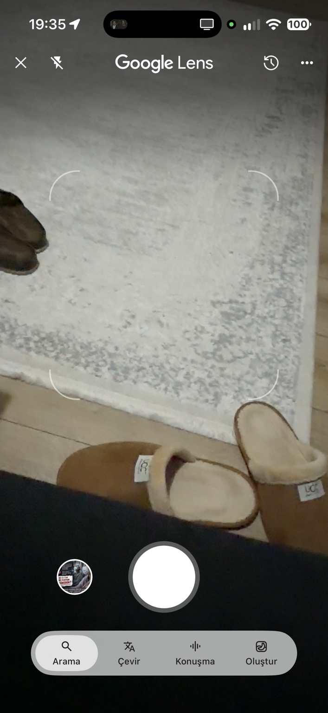
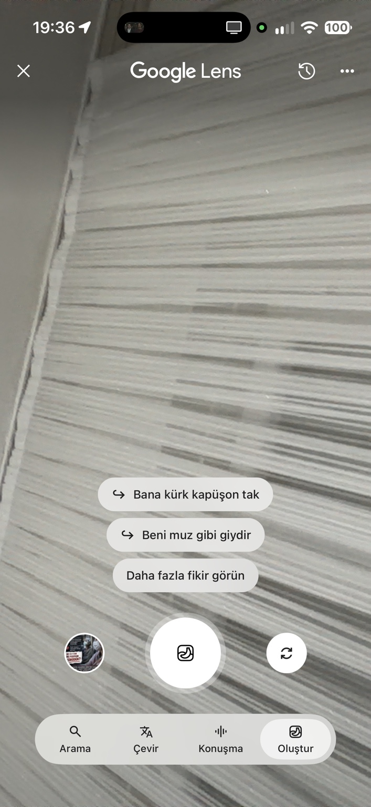

# Orman Mühendisi — tam devir dosyaları

10 Kasım 2026'da hazırlanan paketin talimatı ve iki görseli 11 Kasım'da doğrudan GitHub geliştirme dalına alınmıştır. Yeni tasarım ve kodlama için [kök başlangıç dosyasını](../../BASLA.md) kullan.

## Dosyalar

| Dosya | Kullanım |
| --- | --- |
| [Tam talimat](CLAUDE_Orman_Muhendisi_Tam_Talimat.md) | On üç bölüm, 50 maddelik eski tasarım metni, yedi geliştirme fikri, altı dış veri kaynağı, alan adı ve veri taşıma koşulları. Özgün metin değiştirilmeden aktarılmıştır. |
| [Arama / Tür Bul](referanslar/IMG_6183.jpeg) | Google Lens kamera yerleşimi referansı. |
| [Oluştur / Hazırla](referanslar/IMG_6184.jpeg) | Öneriler, deklanşör ve alt mod şeridi referansı. |
| [Aktarım manifesti](aktarim.json) | Kaynak paketinin ve eklenen dosyaların SHA-256 değerleri; v67 ile güncel dal karşılaştırması. |

## Kaynak kodu

V67 kaynağı [c5b6ca9 commit'i](https://github.com/suleymanozyurt/Orman-Muhendisi-Site/commit/c5b6ca989bec5d5f9c09ffca931b997c8861e52a) ile bu dala önceden alınmıştır. Kamera, tasarım ve önizleme için sonraki geliştirmeler de vardır. ZIP'i yeniden yüklemek veya eski kaynakla bunların üzerine yazmak gerekmez; kaynak kodu depodaki `app/`, `public/`, `db/`, `drizzle/`, `scripts/`, `tests/` ve ilgili dizinlerden doğrudan geliştirilir.

Bu aktarım öncesi dal başı: `bfa7a5b54c308e3c52cfb15be498408dfe25ad0c`.

Özgün v67 kaynak ZIP'iyle GitHub'daki bu dalın karşılaştırmasında 1.048 dosya birebir aynıdır. On dört dosyada daha yeni kod veya GitHub uyarlaması bulunur; bunlar korunmuştur. ZIP'teki on üç `.vinext/fonts/` dosyası üretilen yerel font önbelleğidir ve kod aktarımına yeniden eklenmemiştir. Tam liste manifesttedir.

Özgün tam talimatta ZIP'e ve ChatGPT dosyalarına yapılan atıflar tarihsel kaynak bilgisidir. Çalışmak için yukarıdaki yerel depo yollarını ve kökteki `CLAUDE.md` güncel notlarını kullan.

## Kamera referansları

### Tür Bul

### Hazırla

Referanslar görsel ve etkileşim hedefini tarif eder; Google'ın kapalı kaynak kodunu, arama motorunu veya marka kimliğini devrettiği anlamına gelmez. Uygulamanın adı Orman Lens olarak kalır; işlevler ormancılık ve saha gözlemine uyarlanır.

## Yayın durumu

Bu commit yalnız dokümantasyon ve referans aktarımıdır; uygulama davranışını veya canlı yayını değiştirmez. Depo özel kalır. Pages iş akışı ve mevcut önizleme araçları korunur; bu aktarım Pages'in yayımlandığı veya tam uygulamanın GitHub Pages'te çalıştığı anlamına gelmez.

Canlı kullanıcı kayıtları, yüklenen medya, gizli anahtarlar ve DNS ayarları bu dosya aktarımının kapsamında değildir.
